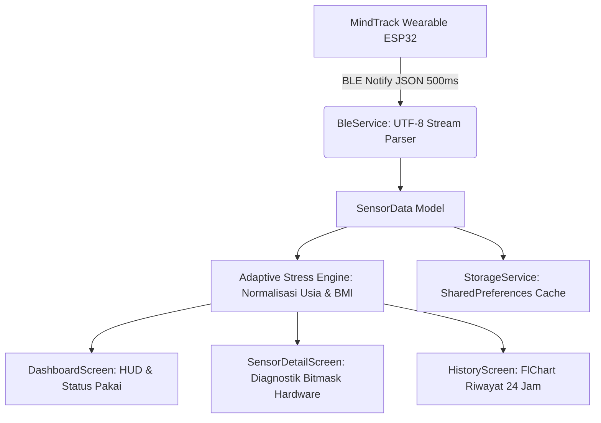

# MindTrack Pro: Aplikasi Monitoring Stres & Kesehatan Biometrik

MindTrack Pro adalah aplikasi mobile berbasis Flutter yang berfungsi sebagai antarmuka penerima data dan analisis fisiologis real-time dari perangkat wearable **MindTrack** (XIAO ESP32-C3). Aplikasi ini melakukan akuisisi telemetri nirkabel via Bluetooth Low Energy (BLE), normalisasi indeks stres adaptif terhadap profil pengguna (Usia & BMI), visualisasi tren historis, serta penyajian rekomendasi intervensi mental secara personal.

---

## 1. Arsitektur & Alur Kerja Aplikasi



### A. Alur Pemrosesan Data
1. **Stream Buffering:** Paket data JSON dari karakteristik BLE diurai secara asinkron menggunakan buffer chunk berbasis delimiter kurung kurawal `{ ... }` untuk mencegah fragmentasi paket MTU.
2. **Decoding Telemetri:** Nilai detak jantung, IBI, HRV, suhu kulit, GSR, status deteksi pemakaian (*wear detection*), bitmask integritas sensor, dan akselerasi 3-sumbu diinstansiasi ke dalam model data objek.
3. **Normalisasi Fisiologis:** Indeks stres mentah (*Fusion Index*) disesuaikan berdasarkan penurunan alami HRV seiring usia dan beban kerja kardiovaskular berdasarkan Body Mass Index (BMI).
4. **Analisis Kontekstual:** Menghasilkan deskripsi klinis singkat dan latihan pernapasan/tindakan fisik saat terdeteksi stres mental tinggi atau beban termal berlebih.

---

## 2. Spesifikasi Protokol Komunikasi BLE

Aplikasi terhubung ke perangkat keras melalui profil atribut generik (GATT) dengan konfigurasi berikut:

| Parameter | Konfigurasi | Deskripsi |
| :--- | :--- | :--- |
| **Device Name** | `MindTrack_BLE` | Nama siaran periklanan (*advertising name*). |
| **Service UUID** | `4fafc201-1fb5-459e-8fcc-c5c9c331914b` | Layar layanan utama instrumen MindTrack. |
| **Data Characteristic** | `beb5483e-36e1-4688-b7f5-ea07361b26a8` | Properti: `READ + NOTIFY` (Transmisi payload JSON 2 Hz). |
| **Command Characteristic** | `beb5483e-36e1-4688-b7f5-ea07361b26a9` | Properti: `WRITE` (Kirim perintah kontrol, misal: `"ping"`). |
| **MTU Size** | 247 Bytes | dinegosiasikan otomatis saat proses *handshake*. |

### Format Payload JSON

```json
{
  "worn": 1,
  "hr": 78,
  "ibi": 769,
  "hrv": 32,
  "st": 45,
  "t": 36.5,
  "g": 42,
  "ir": 115200,
  "ss": 31,
  "ts": 128,
  "ax": 0.12,
  "ay": -0.05,
  "az": 9.81
}
```

| Kunci Data | Tipe | Rentang / Satuan | Keterangan & Penanganan di Aplikasi |
| :--- | :--- | :--- | :--- |
| `worn` | Integer | `0` / `1` | Indikator kontak kulit. `0` memicu banner *Off-Wrist* dan status standby. |
| `hr` | Integer | `0 – 200` BPM | Detak jantung per menit (MAX30102). Menampilkan `--` jika lepas. |
| `ibi` | Integer | ms | Inter-Beat Interval antar denyut nadi berurutan. |
| `hrv` | Integer | ms | RMSSD Heart Rate Variability. Nilai `-1` ditangani sebagai tahap kalibrasi. |
| `st` | Integer | `0 – 100` | Indeks stres fusi akhir dari filter Kalman firmware. |
| `t` | Float | °C | Suhu permukaan kulit tubuh (MLX90614, presisi 1 desimal). |
| `g` | Integer | `0 – 100` % | Persentase konduktansi kulit galvanik (GSR). |
| `ir` | Integer | Nilai raw | Intensitas refleksi inframerah PPG untuk validasi penempatan sensor. |
| `ss` | Bitmask | `0 – 31` | **Status Diagnostik Sensor:** bit0=HR, bit1=HRV, bit2=GSR, bit3=Suhu, bit4=IMU. |
| `ts` | Integer | Detik | Waktu operasional (*uptime*) sistem sejak booting. |
| `ax, ay, az` | Float | m/s² | Vektor akselerometer 3-sumbu MPU6050 untuk kalkulasi magnitude gerak. |

---

## 3. Struktur Modul & Berkas

```text
lib/
├── main.dart                  — Titik masuk aplikasi, inisialisasi layanan, dan konfigurasi tema
├── dashboard_screen.dart      — Layar utama, visualisasi indikator stres, kartu biometrik, dan alert pemakaian
├── history_screen.dart        — Visualisasi analitik historis berbasis grafik garis FlChart
├── models/
│   ├── sensor_data.dart       — Dekomposisi JSON BLE, validasi bitmask status, dan normalisasi stres Usia/BMI
│   └── user_profile.dart      — Representasi profil pengguna dan kalkulasi antropometrik
├── screens/
│   ├── onboarding_screen.dart — Wizard pendaftaran dan inisialisasi profil pengguna awal
│   ├── profile_screen.dart    — Manajemen data personal fisik dan pembaruan foto profil
│   ├── scan_screen.dart       — Antarmuka pemindaian, verifikasi RSSI sinyal, dan koneksi GATT BLE
│   ├── sensor_detail_screen.dart — HUD telemetri mentah, status diagnostik tiap modul, dan log akselerasi
│   └── stress_edu_screen.dart — Modul referensi ilmiah mekanisme stres dan panduan penanganan
├── services/
│   ├── ble_service.dart       — Manajemen siklus hidup Bluetooth, subscription stream, dan buffering paket
│   └── storage_service.dart   — Abstraksi penyimpanan lokal persisten berbasis SharedPreferences
└── widgets/
    ├── app_watermark.dart     — Penanda versi aplikasi minimalis
    ├── app_drawer.dart        — Navigasi modular antarmuka
    └── stress_indicator.dart  — Komponen grafis pengukur indeks stres melingkar
```

---

## 4. Kompatibilitas Lingkungan

| Parameter | Platform iOS | Platform Android |
| :--- | :--- | :--- |
| **Versi Minimum OS** | iOS 13.0 | Android 6.0 (API level 23) |
| **Izin Operasional** | `NSBluetoothAlwaysUsageDescription` | `BLUETOOTH_SCAN`, `BLUETOOTH_CONNECT`, `FINE_LOCATION` |
| **Emulator / Simulator** | Mode Mock Simulasi otomatis aktif | Mode Mock Simulasi otomatis aktif |
| **Perangkat Fisik** | Komunikasi nirkabel BLE penuh | Komunikasi nirkabel BLE penuh |

---

## 5. Dokumentasi Terkait

- Panduan kompilasi dan eksekusi pada simulator, emulator, dan perangkat fisik: [BUILD_AND_RUN.md](BUILD_AND_RUN.md).
- Repositori kode sumber firmware perangkat keras (C++/Arduino): [mindtrack-wearable](https://github.com/ujangsprr/mindtrack-wearable.git).

---

## 6. Lisensi & Kontributor

Proyek ini dirilis di bawah lisensi MIT.  
Dikembangkan oleh [Ujang](https://github.com/ujangsprr) untuk riset integrasi perangkat IoT wearable dan pemantauan kesehatan digital.
